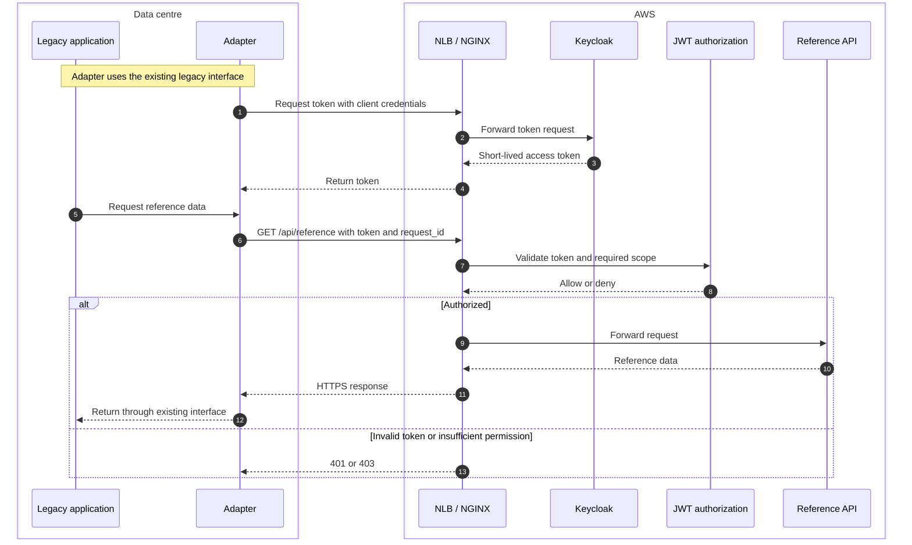
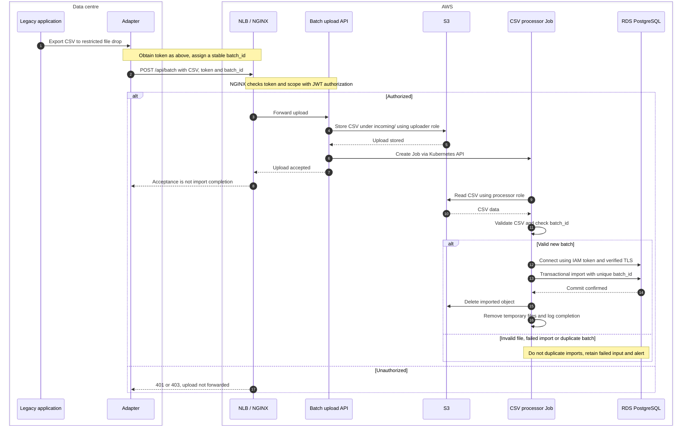

# HTX Hybrid Architecture

Design for both integration modes. [IaC](../infra/README.md) implements dev infrastructure; application workloads and perimeter controls remain proposed. No live deployment has been performed.

## Connectivity

The on-premises data centre (`172.16.0.0/16`) has no Internet access. It connects to the AWS VPC (`10.0.0.0/16`) over Direct Connect, using a private virtual interface with BGP to the VPC's Virtual Private Gateway (VGW).

| Route table | Destination | Target |
| --- | --- | --- |
| AWS VPC | `10.0.0.0/16` | Local |
| AWS VPC | `172.16.0.0/16` | VGW |
| On-premises | `172.16.0.0/16` | Local |
| On-premises | `10.0.0.0/16` | Direct Connect router (BGP) |

Direct Connect avoids public Internet transit but does not encrypt traffic. Application requests use HTTPS. The table shows the broad reference routes; the proposed [security controls](../docs/security.md) narrow on-premises route advertisements to an isolated adapter subnet and enforce firewall boundaries. That perimeter change is not implemented in this IaC.

## AWS network

The diagram shows one private application subnet (`10.0.0.0/24`); the IaC adds `10.0.3.0/24` so EKS and the eventual internal NLB can span two Availability Zones. On-premises DNS maps `api.example.com` to its private IPs. The NLB allows TCP 443 from the adapter or forward proxy and forwards traffic to NGINX Ingress on EKS, where TLS terminates.

RDS uses database subnets in AZ1 (`10.0.1.0/24`) and AZ2 (`10.0.2.0/24`). Its security group permits PostgreSQL 5432 from the EKS node security group. RDS IAM authentication is enabled in the IaC; the CSV processor role can connect only as `csv_processor`, with SQL grants applied through the bootstrap script.

## Why an on-premises adapter

I assume the legacy application cannot be modified, but it can exchange data through an existing interface, such as a file export or import. The adapter handles that interface, obtains an access token, and initiates the API calls to AWS. This keeps integration logic and credentials outside the legacy application and avoids exposing it to connections initiated from AWS.

This is a one-way *initiation* model, not a one-way network link: API responses still return over the same connection. Direct Connect supports traffic in either direction, but the design does not require AWS services to call the legacy application.

## Authentication and authorization

For this machine-only integration, I would prefer mTLS if authentication alone were required. The assignment also requires authorization, so this design uses OAuth 2.0 with Keycloak and the client credentials flow. The two approaches are not mutually exclusive: mTLS could also authenticate the OAuth client. Please refer table below for the comparison. 

1. The adapter requests a token over HTTPS with its Keycloak client ID and secret and `grant_type=client_credentials`. NGINX routes `/api/auth` to Keycloak's realm token endpoint;
2. Keycloak authenticates the client and returns an access token. The adapter sends it as `Authorization: Bearer <token>` with each API request.
3. Before forwarding the request, NGINX asks the JWT validation and authorization layer for a decision. That layer checks the token's signature against Keycloak's public keys, its issuer, audience and expiry, and the roles or scopes required by the requested API.
4. NGINX forwards an authorized request to the API; otherwise it returns `401` or `403`.

| | OAuth 2.0 (client credentials) | mTLS |
| --- | --- | --- |
| Authentication | Keycloak authenticates the adapter using its client credentials before issuing a token. | The TLS handshake authenticates the adapter using its client certificate. |
| Authorization | The API checks token claims, such as scopes or roles, to decide which requests are allowed. | A certificate proves identity; API-level access rules must be implemented separately. |
| Operational needs | Requires Keycloak, token handling, and client-secret management. | Requires certificate issuance, trust, rotation, and revocation. No token service is needed for authentication alone. |

## Encryption and access boundaries

- **Legacy application → adapter:** The immutable application writes to an on-premises drop location readable only by the adapter's service account. If the interface is network-based, it must use an encrypted protocol.
- **Adapter → Keycloak:** The token request travels over HTTPS through the internal NLB and NGINX. Keycloak authenticates the adapter's client ID and secret; this endpoint does not require a bearer token.
- **Adapter → APIs:** HTTPS remains encrypted across Direct Connect and the NLB until NGINX terminates TLS. The NLB restricts source IPs; NGINX permits requests only after the authorization service validates the bearer token and required scopes or roles.
- **NGINX → EKS services:** Use TLS for calls to Keycloak, the authorization service, and the APIs. Kubernetes NetworkPolicies limit which workloads can reach each service; the APIs are not directly exposed to on-premises clients.
- **Batch upload API → Kubernetes API:** Use the cluster's TLS endpoint and the API pod's service account. Namespace-scoped RBAC permits it to create processing Jobs, but not manage unrelated workloads.
- **Batch upload API and Job → S3:** Use HTTPS through the S3 gateway endpoint. Give their service accounts separate, least-privilege IAM roles for uploading and reading CSV objects.
- **Job → RDS:** Require TLS with server-certificate verification. The database security group allows EKS nodes, and the Job uses its IRSA role to generate an IAM database authentication token for a database user limited to the required import operations.

## API flow

After authorization, NGINX routes requests to the appropriate EKS service:

- **Mode A:** `GET /api/reference` serves reference data from EKS.
- **Mode B:** `POST /api/batch` uploads the nightly CSV. The upload API saves it to S3 and creates a Kubernetes Job. The Job reads the file, validates it, writes the results to RDS, and removes its temporary files. The S3 object is deleted after a successful import.

A shared request ID or batch ID connects logs across the adapter and cloud; see [observability and runbook](../docs/observability.md).

S3 is the handoff between the upload API and Job pods. An S3 gateway VPC endpoint lets both pods reach the bucket without an Internet gateway or NAT device.

## Application swimlane flow

Each column is a component's lane. These diagrams describe the proposed application behavior; the workloads are not deployed yet. Cross-boundary requests use HTTPS over Direct Connect through the internal NLB to NGINX. Internal service calls use TLS.

### Authentication and Mode A - Reference API

### Mode B - Nightly CSV import

The adapter initiates cloud connections; responses return on those sessions. No cloud-initiated connection to the legacy application is needed. Carry `request_id` or `batch_id` through logs for correlation.

## Kubernetes workloads

| Workload | Kubernetes resource | Purpose |
| --- | --- | --- |
| NGINX Ingress Controller | Deployment | Terminates TLS, routes requests, and calls the JWT authorization service before forwarding API traffic. |
| JWT authorization service | Deployment | Validates Keycloak-issued tokens and checks access to each API. |
| Reference API | Deployment | Serves `GET /api/reference`. |
| Batch upload API | Deployment | Accepts `POST /api/batch`, uploads the CSV to S3, and creates the processing Job. |
| CSV processor | Job | Reads the CSV from S3, validates it, and imports the data into RDS. |
| Keycloak | Deployment | Issues OAuth 2.0 access tokens to the adapter. |
| AWS Load Balancer Controller | Deployment | Provisions and manages the internal NLB for the NGINX Service; it is not in the request path. |

## High availability assumption

The diagrams show the main traffic path, not a complete HA deployment. Redundancy would require:

- Two on-premises routers and Direct Connect circuits on diverse paths, preferably at separate Direct Connect locations, each with a private VIF and BGP failover.
- The second application subnet is already declared in IaC; deploy the internal NLB in both zones and configure DNS/failover behavior for unhealthy targets.
- EKS nodes across both zones and multiple replicas of NGINX, Keycloak, and the APIs, with Kubernetes Jobs able to run in either zone. Keycloak also needs a highly available backing database.
- RDS Multi-AZ failover. The two database subnets shown are necessary, but do not by themselves enable it.

## Diagrams

- [Page 1 — Hybrid network diagram](./diagrams/Infra-Design-Page-1%20-%20Hybrid%20Network%20Diagram.jpg)
- [Page 2 — Keycloak and API flows](./diagrams/Infra-Design-Page-2%20-%20Keycloak%20and%20API%20Flows.jpg)
- [Editable draw.io source](./diagrams/Infra-Design.drawio)
